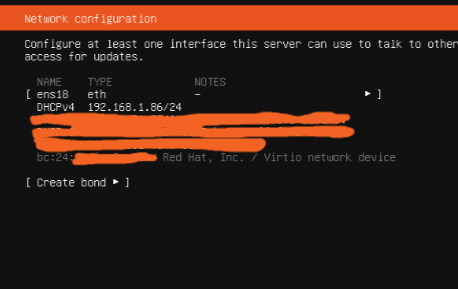
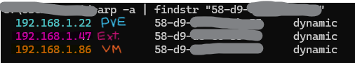

# November 21st, 2026
* Goal: Determine whether the initally chosen WiFi extender properly issues IP and MAC addresses in line with the home network.

* Did:
    * In the Proxmox shell:
        * Ran ip -br a to get NIC name and address
        * Tested routing and DNS by successfully pinging 1.1.1.1 and google.com
        * Checked connection speed using cat sys/class/net/(nic-name)/speed -> 100 Mbps; to be noted that my router supports 1000
    * Created an Ubuntu Server VM using the VirtIO model running on bridge vmbr0
    * Tested VM lease capabilities, performing and observing the following:
        * The Proxmox node and the Ubuntu VM were assigned 192.168.1.x IPs in line with my router's configuration
            * Even though the machine is hooked into the extender (which has its own network repeating my router), pinging the VM @ 192.168.1.68 was successful
            
        * However, running arp -a on my network brought to my attention: **The extender issues different IPs successfully to connected devices, but they share the same MAC as the extender itself**
            * arp -a | findstr "(ext. MAC)" shows 3 devices all sharing the same MAC: the extender (.47), the Proxmox host (.22), and the Ubuntu VM (.86)
            
            * Comparing to the MAC from the Ubuntu Network Config and the MAC given in the Proxmox shell, we can see that the extender is overwriting MACs as its own even when the devices get their own IPs granted in line with the router
        * Also noteworthy, neither device was registered on my router's page or in the extender's page, the router only saw the extender and the extender only noted wireless connections
        * Therefore, the WiFi extender is being discarded going forward
    * Located an older Ethernet powerline (TP Link AV600) and reran the lease test, observing that each system is issued a unique IP and MAC address from my router that is visible from its page
    * Ordered a passthrough TP Link AV1000 for a more ideal setup that allows up to 1000 Mbps transfer

* Broke:
    * The WiFi extender was ultimately hindering this setup, since it was not fully transparent with my network, not issuing unique MAC addresses, and had net transfer speeds too low

* Fix:
    * The WiFi extender is to be ditched and in its place, the TP Link AV1000 will be implemented to allow for direct, quick, and transparent connection with my home router downstairs

* Next:
    * After installing the new powerline, test the VM lease one quick and final time
    * Create an IP reservation for the Proxmox host and reconfigure it where needed

* Time: 2h